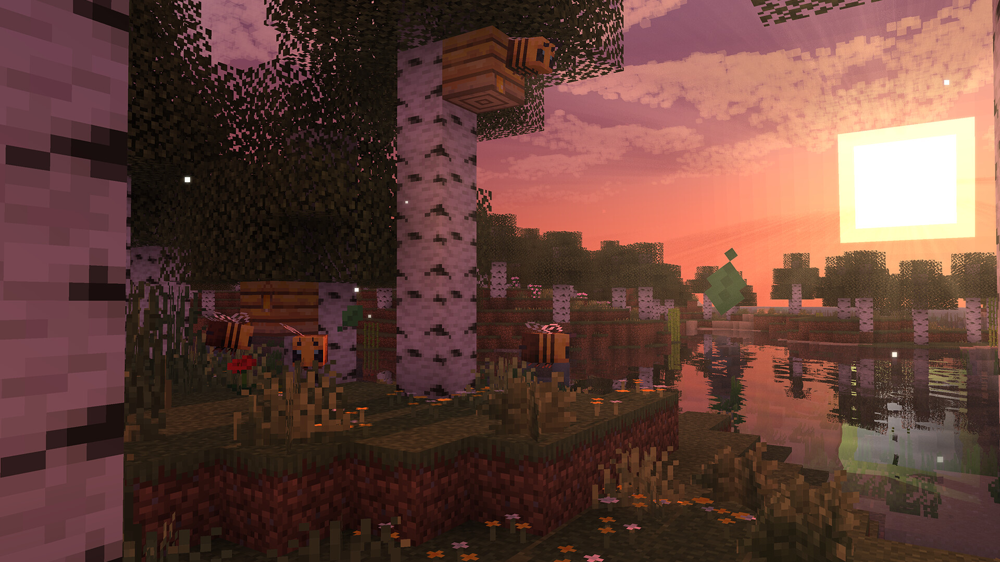
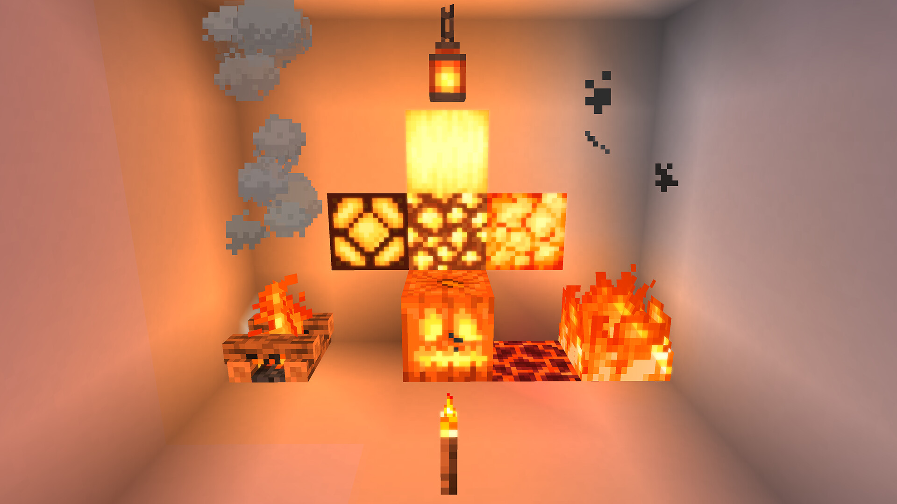
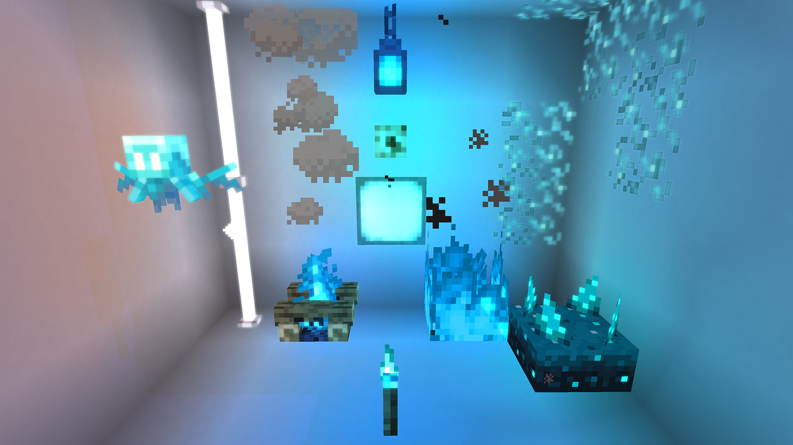
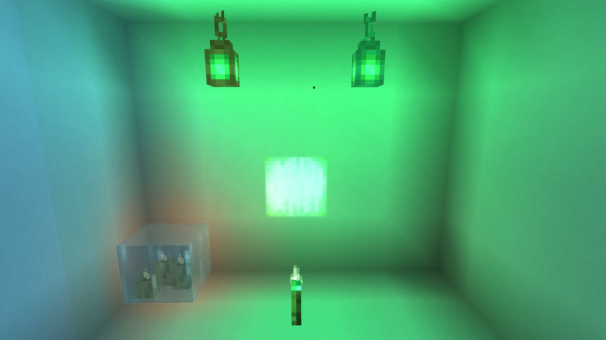
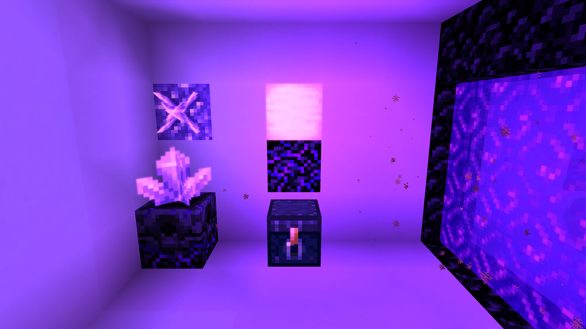
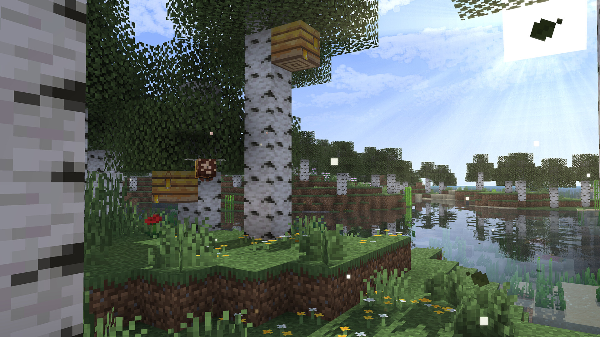
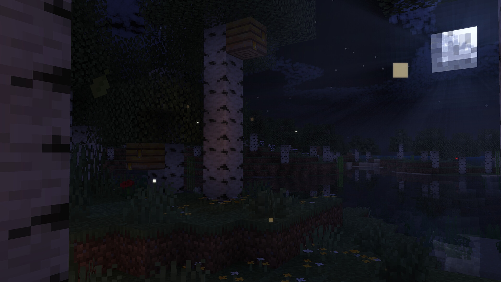

# Miniature XL

A fork of [Miniature Shader](https://github.com/MateusKreuch/miniature-shader) 2.19 by Mateus A. Kreuch, extended with voxel-based colored lighting and a set of related features. MIT licensed, as the original is.

Built and tested against **Minecraft 26.3 / Iris 1.11.7**.

Also available on [Modrinth](https://modrinth.com/shader/miniaturexl).

## Screenshots

### Colored light

| | |
|:-:|:-:|
|  |  |
| Orange | Blue |
|  |  |
| Green | Purple |

### Time of day

| | |
|:-:|:-:|
|  |  |
| Day | Night |

## What this fork adds

**Voxel colored lighting.** Light sources write their palette color, at their real vanilla emission level, into a 3D light propagation volume from the shadow-pass vertex stage; a compute shader propagates it one step per frame around corners but never through walls; the gbuffers read it back for both the hue and the strength of block light.

- per-block-type palette with configurable colors (torch, soul, lava, redstone, amethyst, sea, portal, glowstone, end rod, glow lichen), plus fixed colors for froglights, copper torches/lanterns, sculk, nether stems, creaking heart and more
- adjustable range (32–256 blocks), light reach, color intensity, block light softness
- light sources behind the player keep feeding the volume (*Lights behind you*)
- works in the Overworld, the Nether and the End
- dynamic lights from held items, dropped items, item frames, burning mobs and flaming arrows, and intrinsically glowing mobs
- lava follows a resource pack's biome tint (tested with Nature X) for both its surface and the light it casts

**Lighting and sky.** Sky color screen (sun at noon/dusk, sky tint by time of day) wired into the ambient ground light; time-of-day shadow opacity (full strength by day, faint at night) instead of shadows fading out entirely.

**Bloom.** Per-material emissive masks so only the emitting texels of a block glow (torch flame yes, torch stick no): a lightness-ranked mask (the lightest texels of a texture glow 100%, darker ones less) for fire, lamps, copper bulbs at every oxidation stage, amethyst, crying obsidian, blaze and creaking heart; vein masks for warped and crimson stems (the animated pulse at 100%, the plain veins at 55%); a Photon-like nether portal. Glow ink sign text, the calibrated sculk sensor crystal (stronger while it fires), creaking eyes and the warden's sonic boom glow too. Per-category glow sliders, a sun & moon glow toggle, beacon beam glow and an optional enchantment glint glow.

**Quality profiles.** *Faible*, *Medium* (the defaults) and *Élevé* set shadow, reflection, bloom and colored-light quality together.

**Voxy compatibility.** LOD terrain is excluded from the emissive-overlay glow path, the pack's stylized shading fades back to vanilla before the render distance so the LOD handoff has no visible seam, water reflections and glint fade out before the loaded chunks end (LOD water has neither), and translucent blocks purge the glow buffer so LODs seen through tinted glass do not light up.

## For maintainers

`CLAUDE.md` holds the Iris constraints, the colored-light architecture and the rules that changes must respect. `DEVLOG.md` holds the history: every bug, its actual cause, and the approaches that were tried and rejected.

## Credits

Original shader © 2022 Mateus A. Kreuch, MIT. See `LICENSE` for the full text and the list of modifications.

Screenshots are from the [Modrinth gallery](https://modrinth.com/shader/miniaturexl/gallery).
